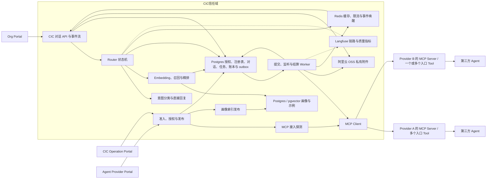
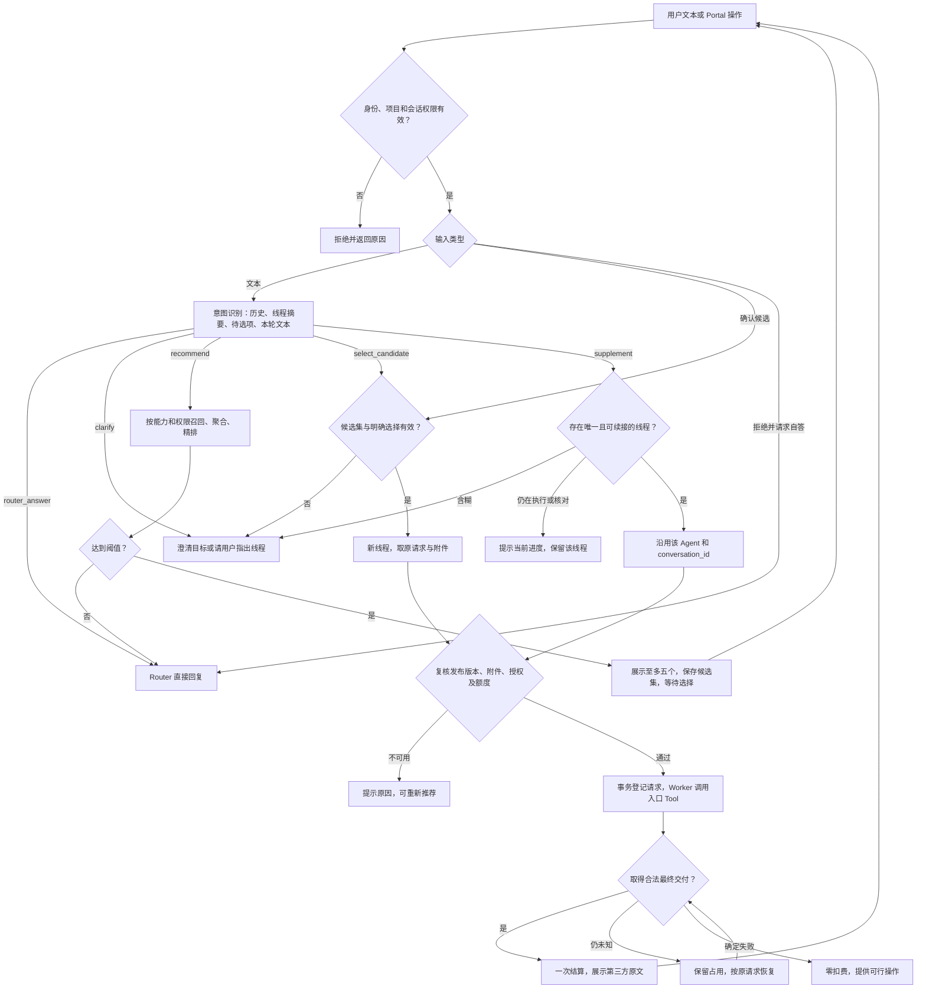
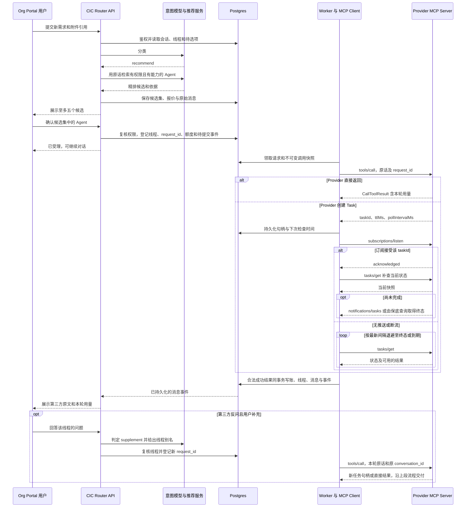

# CIC 多租户 Router Agent 与 MCP 第三方接入规格

**Step 7 · SA&D 建议基线 · 2026-11-22**  
适用于 Org Portal 的对话入口、CIC Operation Portal 的准入与发布、Agent Provider Portal 的 MCP 入驻。文中的“须”表示 CIC 建议对外发布的接入条件或对内实施要求。协议基线为 MCP `2026-07-28` 与同版本 Tasks 扩展；AgentScope、第三方模型、提示词、记忆存储和执行框架均由 Provider 决定。[MCP 版本规范](https://modelcontextprotocol.io/specification/2026-07-28) · [Tasks 扩展](https://github.com/modelcontextprotocol/ext-tasks/blob/main/specification/2026-07-28/tasks.md)

## 1. 架构决策

**采用固定编排、语义分支的 Router 工作流。** “固定”指代码定义可执行动作和状态转移。每句话仍可能走不同路径，一个 CIC 对话可以同时包含多个第三方线程。模型输出意图及目标引用，CIC 代码决定能否调用，用户决定把新任务交给哪一个 Agent。第三方的有效回复按原文展示，并标明来源。

| 决策 | 可选方案与代价 | 首期选择及回退 |
|---|---|---|
| 路由控制 | 提议的固定编排可审计用户选择、授权和费用；自主规划的模型可以组合新工具，但它选择的步骤和调用次数难以约束 | 五类语义意图 + 确定性状态机。模型或检索失败时保留用户输入，允许重试或澄清，不自动提交 |
| 调用与等待 | Router 请求内等待最简单，长任务、掉线和进程重启会影响交付；持久化请求 + Worker 需要处理恢复与重复事件 | 同一代码库可部署 API 和 Worker 两类进程，MCP Client 为受控出站组件。按 Provider 关闭推送即可切回轮询 |
| 推荐 | 仅做向量相似度召回较快；画像加示例并精排可改善近义能力的排序；每轮改写又引入意图和文本变化 | 先做原话召回 + Rerank，最多五个。按租户灰度，退回纯向量时同步切换阈值；用户始终选定新任务的 Agent |

**三个核心接口决策。** 入驻以受保护的 MCP URL、凭证和一个经审核的入口 Tool 为单位。计量从每轮最终 `CallToolResult._meta["com.cic/credit_usage"]` 读取。续聊使用 CIC 线程保存的 Provider 会话句柄；新任务重新推荐，普通问答直接回复，目标含糊先澄清。

## 2. Router Agent 拓扑与职责



| 参与方 | 权限、输入与交付 |
|---|---|
| Operation Portal | CIC 配置 Org、管理员、Provider 准入及操作者权限，审核集成、发布或下架、审计和对账。平台管理操作留操作者与变更记录 |
| Provider Portal | 获准 Provider 仅管理所属 Agent 的草稿、连接探测、沙箱及发布动作。可看自身 Agent 计量；第三方业务不获得 Org 内其他项目、成员或完整聊天历史 |
| Org Portal | 使用者向有写权限的对话提交原话和附件、选择/确认或拒绝候选、查看异步结果和用量。页面只调用 CIC；后端负责每次鉴权 |
| Router | 载入当前会话状态、识别意图、生成候选或回复、绑定线程、持久化调度意图。模型仅见线程别名、必要历史和候选描述 |
| MCP Client / Worker | 查已审核端点和凭证，提交、接管监听、校验结果，归并推送与查询，在事务中交付和结算。API 返回 CIC request_id 即可释放连接 |
| Provider MCP Server | 对外负责身份、入口 schema、句柄和任务生命周期、幂等及每轮用量。一个 Server 可以承载多个 Agent，一个上架 Agent 只绑定一个入口 Tool |

## 3. 问题一 · 入驻字段与校验

### 3.1 Portal 字段

| 字段 | 来源与要求 | 校验或用途 |
|---|---|---|
| Provider、Agent 标识和版本 | Provider 身份从登录主体取得；CIC 分配稳定 agent_id 与配置版本 | 编辑草稿和生产发布指针分离，保留审核人、时间与配置摘要 |
| 名称、描述、分类、标签、示例问题 | 提交时必填；3–10 条非空示例，每条覆盖一类真实问法 | 一段画像 + 每例一个向量。针对预订、购买等外部操作，建议增加经审核的“能执行的动作与限制”，区分建议、比价和实际交易 |
| 集成方式、协议与传输 | MCP，固定版本，远程 HTTPS Streamable HTTP | 无需填写 Agent Card 或单独的 health URL；A2A 仍沿用原接入表单 |
| MCP Server URL、鉴权方式、API Key | 首期 Bearer API Key。密钥写入加密凭证存储，注册表只放 credential_ref、版本和服务身份 | 发起探测前验证端点归属及 HTTPS 出站策略；阻断非许可网络目标，重定向和 DNS 变化须重新校验，跨源禁止转发凭证 |
| 入口 Tool | 从带凭证的 tools/list 中单选；记录 name、title、description、inputSchema、schema 摘要 | 同一个规范化 URL 可承载多个入口；同一生产 (URL, tool name) 只能归属一个逻辑 Agent。版本升级沿用此绑定 |
| 成本单价、币种/单位 | HKD / Credit，有限非负十进制数，允许 0 | 入驻时校验，确认调用时保留版本和单价；Org 销售价由 CIC 的价目规则决定 |
| 系统派生字段 | tested_at、fingerprint、serverInfo、协议、Tasks 声明、supports_image、审核/发布状态 | 图片能力从 schema 派生；是否接受某个 taskId 的推送由运行时订阅确认决定 |

### 3.2 从草稿到可推荐

1. **功能分两段。** Provider 先填 URL 和 Key 获取 Tools，再选择入口并完成针对该 Tool 的探测。带 Key 执行 `server/discover`，确认指定版本和 tools 能力，记录 `capabilities.extensions["io.modelcontextprotocol/tasks"]`。短调用可按直接返回模式接入；预计超出提交预算的入口须在审核中演示快速返回可查询的任务句柄。
2. **查权限及契约。** 匿名 `tools/list` 应返回 401，错误凭证须被拒，合法凭证须能分页获取非空列表。Tool 名符合 `[A-Za-z0-9_.-]{1,128}` 且唯一，inputSchema 是有效的对象 JSON Schema。入口须可由下表参数调用；条件约束也不能要求 CIC 无法提供的字段。单一非空类型与 null 的 anyOf 可用于可选字段。
3. **绑定证据。** 记录 `fingerprint(url, key 摘要, entry_tool)`、schema 摘要及时间；连接结果在 15 分钟内供下一步和正式提交使用，改端点、Key 或入口立即失效。探测只读，失败标出步骤并阻断提交审核。收费的 tools/call、实际反问、续接、计量和 Tasks 行为在 Expert Sandbox 用隔离账号与账本验收。
4. **沿用三端状态。** Draft 仅 Provider 可见；提交 → Expert Sandbox → 审核通过至 Pending for Publish → Published。可退回 Changes Requested 或 Rejected。Published 可下线至 Deactivated 或由运营退回沙箱。可推荐须同时满足 Published、通过审核的版本/索引已就绪、对调用主体可见、能力匹配。技术故障用独立健康标志暂停新调用，避免混淆门户业务状态。
5. **处理变更。** 新版本向量和探测证据准备齐全后，事务切换活动版本；下架提交立即生效并发送缓存失效事件。已受理任务沿用提交快照完成。续聊时版本或凭证变化须能证明仍服务原会话和调用身份；不能兼容或 Agent 下架则提示用户重新选择。定期探测 schema 漂移、鉴权失效与服务健康。

### 3.3 入口 Tool 的 CIC 契约

| 位置 | 要求 |
|---|---|
| `params.name` | 已审核的入口名。模型和前端均不能指定任意 Tool、URL 或 key |
| `arguments.message` | 必填字符串，首次为引发推荐的用户原话，续轮为本次补充。不得把“选第一个”、模型生成的 search_query 或整段 CIC 聊天历史作为首次任务 |
| `arguments.conversation_id` | Tool 必须声明为可选字符串。首轮省略，Provider 签发；续轮原样传回，结果须回显同一值。未知或过期返回明确错误，不能静默新建 |
| `arguments.image_urls` | 仅支持图片的 Tool 声明，可选字符串数组。CIC 在每次提交前逐项确认本次对话的附件权限和能力，按执行窗口签发 OSS HTTPS 地址。附加参数只能是可选项 |
| `params._meta` | 携带 MCP 请求版本、Client 身份/能力，以及 CIC 的 `com.cic/request_id`（本次执行尝试的稳定幂等键）和 `traceparent`。租户身份由认证服务绑定，任何业务字段或模型输出均不能充当授权依据 |
| 最终 `CallToolResult` | `structuredContent` 包含非空 conversation_id、枚举 status 与用户可读的字符串 reply；content 至少一个 text 块与 reply 相同。成功用量见 §5；isError 为 true 时按失败处理 |

以下为 `tools/call` 的业务参数示例，传输层由 Client 补齐协议元数据和头部。续轮省略图片时只需 message 和 conversation_id。

```json
{
  "name": "trip_planner",
  "arguments": {"message": "预算改为两万元", "conversation_id": "conv_trip_18"},
  "_meta": {
    "io.modelcontextprotocol/clientCapabilities": {"extensions": {"io.modelcontextprotocol/tasks": {}}},
    "com.cic/request_id": "req_102",
    "traceparent": "00-4bf92f3577b34da6a3ce929d0e0e4736-00f067aa0ba902b7-01"
  }
}
```

## 4. MCP Tasks 配合与恢复

下面是长任务受理时返回的 JSON-RPC result。此时已有可读取的任务，还没有可以结算的用量。

```json
{
  "resultType": "task",
  "taskId": "task_81",
  "status": "working",
  "createdAt": "2026-11-22T10:00:00Z",
  "lastUpdatedAt": "2026-11-22T10:00:00Z",
  "ttlMs": 3600000,
  "pollIntervalMs": 2000
}
```

| 阶段 | CIC MCP Client | Provider MCP Server |
|---|---|---|
| 提交 | 每次请求声明协商能力，按协议发送版本、Mcp-Method，tools/call 的 Mcp-Name 为 Tool 名。先持久化再出站 | 校验 Bearer、参数与身份。相同调用身份、入口、request_id、相同业务内容返回原句柄或原直接结果；同键异内容报冲突。去重记录至少覆盖双方约定的最长重放窗口 |
| 返回 | 可接收 `resultType=complete` 的直接结果，也可接收 `resultType=task`；持久化 taskId、createdAt、lastUpdatedAt、ttlMs、pollIntervalMs | 双方声明 Tasks 后，Server 逐次决定返回形态。返回 task 前保存任务，确保授权的 get 能立即查询、重连及换实例后仍可读取。CIC 要求 ttlMs ≥ 3,600,000 或显式 null；短 TTL 在实验仅告警，生产沙箱判为不满足保留期 |
| 观察 | `subscriptions/listen` 的 notifications.taskIds 请求订阅；核对 acknowledged 接受的 ID，随即 get 一次补上订阅前的窗口。推送正常时也低频补查；未接受、丢推送或中断则按最新 pollIntervalMs 轮询 | `tasks/get` 必须可用；推送可选。若推送，`notifications/tasks` 提供与 get 一致的完整状态。只返回已授权 taskId；订阅过滤集合固定，增加 ID 需重建订阅 |
| 状态 | 核对身份、taskId、合法状态和时序；忽略重复与过时状态。识别 working、completed、failed、cancelled | 完成时 result 为原 CallToolResult。JSON-RPC 执行错误置 failed 并带 error；Tool 业务报错可以是 completed 且 result.isError=true。终态不可逆 |
| 反问 | 本轮 Task 已完成，解析业务 `structuredContent.status=input_required`，记账并等待用户；补充启动下一次 tools/call，沿用 conversation_id，生成新 request_id | 开放式反问遵守上述约定。协议层 task.status=input_required 携带 inputRequests、由 tasks/update 回答；CIC v1 未接入该交互，Provider 入口须避免产生。若违规，停止业务交付、记录、请求取消并跟踪收尾 |
| 取消与过期 | tasks/get、tasks/cancel 使用 `Mcp-Name: <taskId>`。取消 ACK 表示已接收意图，继续观察最终胜出的终态。以 createdAt 加最新 ttlMs 为恢复边界；null 使用约定的运维处置窗口 | cancel 只作用于所属调用方的任务，不能改写已完成结果。按保留协议提供结果；告知调用方会话的保留策略，会话句柄可跨多轮 Task 使用 |

遇到 429、短暂 5xx、推送断开或 Worker 重启，按租户和 Provider 限流、退避并加随机抖动；持久化 next_poll_at、lease_until、lease_epoch。接管者从数据库恢复订阅并补查，旧 Worker 不能凭过期租约写状态。已提交但没拿到句柄时标记 submitting_unknown，用**同一个** request_id 恢复；没有通过幂等审核的端点只允许查询或人工核对。连续三次失败可触发降级告警。失联期间挂起结算和同线程后续执行；过期、约定恢复期限耗尽且无可验证结果时关闭为未交付、零扣费，迟到冲突转对账。若远端仍可能占用旧会话，将其封存，新请求须显式开新线程。

## 5. 问题二 · Credit 协议与结算

**唯一第三方用量来源是最终 CallToolResult 的 `_meta["com.cic/credit_usage"]`。** 直接返回时路径为 JSON-RPC `result._meta`；通过 tasks/get 取回时为 `result.result._meta`；订阅终态通知为 `params.result._meta`。三条路径共用同一校验与结算函数。以下示例为 tasks/get 的 JSON-RPC result 对象。

```json
{
  "resultType": "complete",
  "taskId": "task_81",
  "status": "completed",
  "createdAt": "2026-11-22T10:00:00Z",
  "lastUpdatedAt": "2026-11-22T10:00:03Z",
  "ttlMs": 3600000,
  "pollIntervalMs": 2000,
  "result": {
    "content": [{"type": "text", "text": "计划玩几天？"}],
    "structuredContent": {"conversation_id": "conv_trip_18", "status": "input_required", "reply": "计划玩几天？"},
    "isError": false,
    "_meta": {"com.cic/credit_usage": 701}
  }
}
```

| 条件 | 本轮账务及交付 |
|---|---|
| 完整成功结果，业务状态 completed 或 input_required | 接收本轮实际总量，JSON number、有限且 ≥ 0，允许零和小数，按十进制存储。反问按当轮计，下轮独立结算，禁止把会话累计值上送 |
| 缺失、负数、null、布尔、字符串、非有限值，或回包与会话、任务、回复契约不符 | 合同错误，当前轮不扣费，不标为成功。记录脱敏原因与证据供 Provider 对账 |
| 仅受理、working、连接断开、取消 ACK | 无结算动作，保留可恢复状态。合法终态到达后再判断 |
| failed、cancelled、确定过期、RPC 错误、isError=true | 不收本轮第三方费用。早先已成功交付的轮次保留原账；即使正文写“成功”也不能改判 |
| 重复事件、直接结果重放、推送与轮询同时到达 | 同请求只产生一条第三方结算和一条用户交付。相同键但内容/金额不同则隔离，保留原始账与审计记录 |

**事务边界。** 在同一个 Postgres 事务内锁住请求和额度账户，条件更新执行状态，写用量、资产扣减、线程状态、用户消息和 outbox 事件。以 `request_id` 唯一标识第三方结算；异步结果另有唯一 `(provider_service_identity, task_id)`，其中 service_identity 覆盖端点及经过认证的调用方命名空间。两种键均关联到同一条执行记录，禁止同一个已归属的任务绑定第二个租户。CIC 使用数据库记录的 org/project/user、价格和授权快照；Provider 不能指定付款主体、单价或最终金额。

**金额与余额。** Provider 成本 HKD = 当轮 Credit × 调用时 Provider 成本单价。Org 售价、优惠、汇率按 CIC 对应价目快照另算，保存 Credit、HKD、适用时的 USD、免费/付费分摊（先免费）及舍入规则版本。提交前按额度策略原子预留，成功后释放差额或按已批准上限处理，失败释放；未约定封顶的调用须明确欠额/超额承担策略后才开放硬额度承诺。实验中的 1 token = 1 Credit、0.0001 HKD/Credit 只适用于模拟 Provider。意图、推荐和自答的模型成本独立记录到 CIC 自身计量，禁止混入第三方用量或用 Langfuse 估算值扣款。

## 6. 问题三 · 推荐、选择与下一轮路由

### 6.1 推荐规则

1. 入驻时将名称、分类、标签、能力描述合成一个画像向量，每个示例问题再生成一个向量。生产用 pgvector 存 `agent_version_id, kind, text, embedding_model, dim, embedding`；首期以 text-embedding-v4 的 1024 维 cosine 与实验对齐。索引按模型版本构建，同维度的不同模型也不能混排。
2. 用户提出专业新任务才做在线 Embedding。使用该轮原话，图片只参与能力过滤，`search_query` 在首期仅供脱敏诊断。先限定租户可见、项目可用、Published、可调用的活动版本。涉及外部执行时要求匹配已审核动作；仅会规划旅行的 Agent 不能承接订票。证据不足可澄清“需要订票还是行程建议”。
3. 按每个 Agent 的最高命中向量分聚合，保留命中画像或示例作为解释。实验先取至多 20 个**不同 Agent**，用 qwen3-rerank 对各 Agent 的描述文档精排，再逐候选使用独立阈值，降序取至多 5 个。pgvector 实现须关注近似索引叠加权限过滤后的候选不足；在可见范围内扩大扫描或精确补查，不能让同一 Agent 的多条示例占满五个位置。[pgvector 过滤与迭代扫描](https://github.com/pgvector/pgvector#filtering)
4. 初始 Rerank 阈值 0.48，关闭精排时向量阈值 0.45。精排超时可以退回向量排序并记录降级，禁止混用评分尺度。产品展示匹配依据、Provider、价格和能力限制；原型的百分制展示和“60%”与模型分数没有校准关系。候选只有 1–4 个就展示实际数量，零个或用户拒绝时可由 Router 在自身能力范围内回答。
5. 候选集保存原消息及附件引用、Agent 版本、报价、排序、过期时间、选项所属消息。选择只解析到这一集合。Portal 保留“选中 → 确认”交互，确认后才提交；自然语言“用第一个”可视作对当前明确候选的确认。另一条新需求取代旧候选；异步失败提示属于对应线程，不覆盖用户正在确认的另一张卡。价格或版本变化须刷新选择。

### 6.2 Router Agent 流程图



| 本轮输入和已有状态 | 决策 | 用户看到的行为 |
|---|---|---|
| T1 旅行规划在问预算，用户说“预算改成两万” | supplement(T1) | 向 T1 的 Agent 发本轮原话和原句柄，无需再选。T1 正在处理时显示进度，本条补充未提交 |
| T1 已交付，用户说“第二天的行程换成购物” | supplement(T1) | 沿用原第三方记忆，创建新的执行请求。若句柄过期，说明原因，征得用户选择后开新线程 |
| 用户请“把刚才行程译成英文”或另问简单问题 | router_answer | Router 使用可见历史直接答，其他待补充线程保持原状态 |
| “再规划一次大阪旅行”，即使上一单也是旅行 | recommend | 作为新的任务重新推荐；再次选同一 Agent 也从新的第三方会话开始 |
| T1、T2 都等信息，“好的，就这样”可指两者 | clarify | 展示线程别名和各自等待的内容，由用户指明后续接 |
| “周报那个”不在当前候选，或提供失效/越界编号 | 新需求重新推荐；无效选择澄清 | 不凭模型生成的名字或编号越过候选授权。明确拒绝时可直接自答 |
| 失败后的“重试”或“换一个” | 解析当前失败卡片 | 已知失败时可重发失败的原文与附件、沿用可用句柄；换一个则排除失败 Agent 后重新推荐。结果未知只执行恢复 |

对“写邮件”等既可自答又有专业 Agent 的任务，首期沿实验口径：基于已有文本的翻译、总结和润色优先自答；用户明确要求专业能力或外部执行时进入推荐。缺少执行对象或指代不清时澄清。意图模型只返回 `intent, thread_ref, candidate_index, search_query, reason`。代码复核目标和授权；分类失败时给出可恢复提示，不能猜一个付费动作。

### 6.3 Router Agent 时序图



## 7. 多租户存储、接口与运行

**持久化时序。** API 收到确认后，以同一事务消费候选、登记本轮执行请求与待提交事件；此时 UI 显示“CIC 已受理”。Worker 获取租约后，在首次出站前再核对授权和活动版本。后台恢复同一已出站请求时固定原身份、配置和业务载荷，通过幂等重放取得原句柄或直接结果。附件签名刷新时须保持原授权对象与业务内容一致。终态提交后异步发布用户事件；即使通知丢失，用户仍能从原会话读回结果。

### 7.1 主键、授权范围与一致性

| 记录或组件 | 关键字段及约束 |
|---|---|
| 租户/项目授权 | 服务端从身份会话派生 tenant_id、user_id；企业会话须绑定有权限的有效 project_id。个人账号采用独立个人租户，project_id 为空。业务表带租户键，关联使用含 tenant_id 的外键；行级策略或等效强制过滤覆盖列表、详情、附件、SSE 重放和运维查询 |
| CIC 对话、消息、线程 | chat_id 是用户对话；thread_id 是一次经选择的第三方会话，T1 等只在本次 chat 内有效。线程绑定 chat、agent、service_identity 与远端 conversation_id，同一远端绑定不可归属不同租户。同一 thread 的提交中、运行中或结果不明记录最多一条，以 PG 条件唯一约束保障首轮也互斥；不同 thread 可并行 |
| 注册表与候选 | Provider 主体、逻辑 Agent、不可变 agent_version、凭证引用、活动版本、访问范围、探测证据、价格。candidate_set 绑定 tenant/chat/message/version，有时效、消费状态及每项展示信息。确认时锁定或比较版本并原子消费，消息到达顺序由服务端序号决定 |
| 请求与远端映射 | request_id 在出站前生成；入口按 (tenant, user, client_message_id 或 confirm_action_id) 去重。同键同载荷返回已有资源，同键异载荷冲突；两次真正的用户补充有各自的 ID。request 保存 turn_id、thread_id、授权主体、期望句柄、配置/价格/凭证版本、负载摘要及 task_id；Provider 端按服务身份及入口核验归属，手持句柄本身不能跨主体操作 |
| 账本、预留和 outbox | 仅 PG 为账和消息的权威来源；按 §5 事务提交，事件有稳定 event_id 和 chat 内单调 seq。重复消息由消费者去重；浏览器断线后按游标补拉。沙箱流量与生产账、权限、对象命名空间分离 |
| Redis | 热注册数据、权限版本提示、租户/Provider 限流、唤醒与短期去重缓存。限流键含租户或 Provider 作用域；防重和单线程互斥最终落在 PG。Redis 清空后可从持久表扫描恢复，拒绝依赖旧缓存执行已撤权的操作 |
| OSS 与 Provider 隔离 | 私有 bucket，以租户/项目/对象 ID 作键。后端签发限定对象、方法、用途和期限的上传/下载凭证；校验大小、实际媒体类型和归属。Provider 仅得本轮所需对象，后台执行超过链接时效须走双方约定的续签或提前取件。共享 Provider key 时 CIC 是对外授权边界；有独立租户授权要求的服务使用租户专属凭证或可信租户声明 |
| Langfuse | 一轮 trace 串起 intent、embedding、检索、rerank、submit、watch、settle；以 request_id 和不透明 chat/session 标识跨异步工作关联。记录模型/提示版本、耗时、分数、交付渠道与错误类型；默认脱敏，过滤 API Key、签名 URL 和原始第三方句柄。采集失败不影响交付或账本。[Langfuse tracing](https://langfuse.com/docs/observability/overview) |

### 7.2 Portal API 对接建议

以下是 SA&D 逻辑接口，路径为建议命名。所有写操作使用服务端鉴权；跨租户资源用统一的不可见响应，前端不得提交远端 taskId 替代 CIC request_id。

| 动作 | 请求与结果 |
|---|---|
| Provider 探测/提交 | `POST /provider/agents/{id}/probe` 返回步骤、可选 Tools、能力、fingerprint、tested_at；`POST /provider/agents/{id}/submit` 绑定版本和有效证据进入沙箱。Operation 审核和发布操作记录版本、操作者及时间 |
| 用户发言 | `POST /chats/{id}/messages` 提交 client_message_id、text、attachment_ids，可带本次所指的线程/卡片标识。返回 CIC message_id；后续事件可为 router_reply、clarification、candidates、processing、agent_reply、failed |
| 确认或拒绝 | `POST /chats/{id}/selections` 携带 action_id、candidate_set_id、候选项 ID 和 confirm/decline。确认成功返回 202 和 request_id；旧卡/版本冲突返回 409 并刷新，额度或权限不足不出站 |
| 取消/恢复/重放 | `POST /requests/{id}/cancel` 记录取消意图；已执行的直接调用无法承诺终止。GET 请求详情返回 CIC 状态；`GET /chats/{id}/events` 支持 SSE 和游标重放，重授权后读取消息快照。退出页面不取消任务，撤权后禁止继续读结果 |

### 7.3 容量、降级与发布验收

- **按负载扩容。** 并行度近似为受理速率 × 平均执行时间，轮询 QPS 近似为待查任务数 ÷ 间隔秒数。例如 1,000 个任务每 2 秒各查一次约 500 QPS，这是容量估算。按租户/项目设在途与额度上限，按 Provider 控制连接池、并发和 QPS。合并同一服务身份的 taskIds 订阅时，重建期间用 get 补查。API、提交 Worker、监听 Worker 可分别调节并发，避免慢 Provider 耗尽其他租户资源。
- **量测分段。** 记录意图延迟、候选生成耗时、Portal 受理至首次提交、Provider 受理时间、终态到入账/交付、在途数与最老待处理年龄、未知提交数、合约错误、推送覆盖率、补查/轮询占比和对账差额。按租户分层抽样，自答/推荐边界、能力误配、Hit@5、实际选择与放弃率分别观察；生产吞吐、SLO 及阈值须经目标环境量测确定。
- **逐步迁移。** 先用留存样本及沙箱 Provider 对照 pgvector 与本地排序；对同一请求只做旁路计算，禁发第二次外部执行或扣款。再小范围启用持久 Worker 和门户事件，按租户启用候选上限 5。回退只影响新请求的策略版本；旧 Worker 排空在途任务，沿原请求快照交付。索引可切回前一已审核版本，账本只以冲正记录修订。
- **可观察的上线验收。** 两个租户即便提交同名项目/会话、使用同一 Provider，也只能看到各自候选、消息、附件及账单。双击确认、响应丢失、推送和轮询交叉返回、提交后 Worker 切换均收敛为一次外部执行、一次交付和一笔用量。下架后新请求被拒、在途按快照结算；未授权附件不会出站；无售票能力时订票请求不展示可订票候选；外层 completed 但 isError=true 或缺用量时扣费为零。

## 8. 实验依据及适用范围

实验为 CLI + YAML + 内存状态 + 本地 Qdrant；实际调用了百炼模型及 OSS。Provider A/B 上仅 3 个可调用 Agent，其余 12 个只有画像。项目使用 Claude Opus 5.5 展开实验设计与实现；下列运行时指标来自报告指明的 qwen4-max、text-embedding-v4 和 qwen3-rerank。更换 Router 模型须重测意图边界、结构化输出和延迟。

| Step 6 同批复跑，40 条 | Hit@1 / Hit@2 | MRR | 无合适拦截 / 正常误拦截 | 平均 / P95 |
|---|---|---|---|---|
| V1 画像 | 82.9% / 100% | 0.914 | 100% / 0% | 161 / 335 ms |
| V2 画像 + 例句 | 94.3% / 97.1% | 0.967 | 100% / 2.9% | 159 / 289 ms |
| V3 加 Rerank | 94.3% / 100% | 0.971 | 100% / 0% | 371 / 585 ms |
| V4 意图门控 + 改写 + V3 | 80.0% / 80.0% | 0.800 | 100% / 20.0% | 3028 / 4144 ms |

Hit@k、MRR 的分母是 35 条有目标的问题；拦截率的分母是 5 条无目标问题，按各方案样本内建议阈值报告。单独意图集以 qwen4-max 判对 34/34，平均 2267 ms，P95 3262 ms。V4 在另一组标注上提前分流了 7 条；因此本期保留原话检索，并应在相同意图门控下比较原话和改写。V3 的 585 ms 仅为推荐阶段，不能作为用户发言到拿到候选的 P95。人工“订票”实录也表明阈值不足以判断执行资格。[Step 5 记录](step5_test_result.md) · [Step 6 记录](step6_test_result.md)

多租户生产部署、Top 5 用户选择率、真实容量、灾后恢复和外部 Provider 认证留待上线验收。门户确认交互参考相邻原型 `web-org-portal/src/lib/routing.ts`，其关键词排序只展示三项；实验 CLI 默认至多两项，生产目标为至多五项。完整审查、源码位置及人工记录偏差见 [Step 7 代码审查](step7_code_review.md)。


